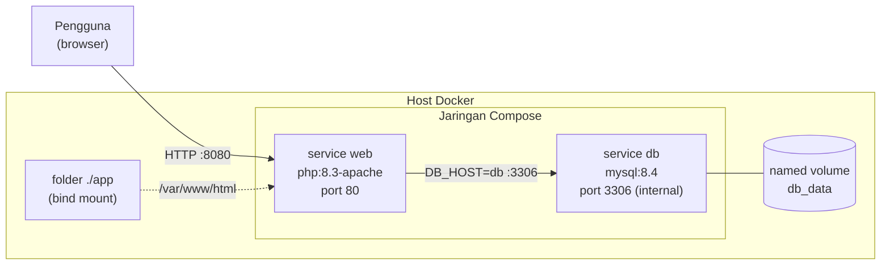

# Arsitektur Sistem

Aplikasi kas organisasi berjalan sebagai satu stack Docker Compose berisi dua service, yaitu `web` (PHP-Apache) dan `db` (MySQL).

Versi gambar untuk laporan atau slide: [arsitektur.png](arsitektur.png).

## Komponen

| Komponen | Fungsi |
|---|---|
| Pengguna (browser) | Mengirim permintaan HTTP ke host Docker pada port 8080. |
| Host Docker | Mesin yang menjalankan Docker Engine dan Compose. Berbeda dari container yang berjalan di dalamnya. |
| Service `web` | Container `php:8.3-apache` (dibangun dari `Dockerfile` yang menambah ekstensi mysqli). Memvalidasi input dan menjalankan query. Port host 8080 diteruskan ke port 80 container. |
| Service `db` | Container `mysql:8.4` yang menyimpan tabel `transaksi`. Port 3306 tidak dipublikasikan ke host dan hanya diakses dari service `web`. |
| Jaringan Compose | Jaringan bawaan Compose. Service `web` menghubungi MySQL lewat nama service (`DB_HOST=db`, port 3306). |
| Named volume `db_data` | Terpasang ke `/var/lib/mysql` agar data tetap ada setelah container dibuat ulang. |
| Bind mount `./app` | Kode aplikasi dipasang ke `/var/www/html` pada service `web`. |
| Konfigurasi | `DB_HOST=db`, `DB_NAME=kas`, `DB_USER=app`. Password dibaca dari file `.env` (tidak diunggah ke repositori). |

## Alur satu transaksi

1. Bendahara mengisi form (jenis, keterangan, nominal) lalu menekan **Simpan** (HTTP POST ke `host:8080`).
2. Service `web` memvalidasi input: jenis valid, keterangan tidak kosong, nominal berupa angka lebih dari 0.
3. Service `web` menjalankan `INSERT` ke `db:3306` melalui jaringan Compose.
4. MySQL menyimpan baris baru pada volume `db_data`.
5. Aplikasi membuka kembali halaman utama, menjalankan `SELECT`, lalu menampilkan transaksi terbaru beserta total saldo.

## Catatan host

Pengujian saat ini dijalankan di Docker Desktop (Windows). File Compose yang sama dipakai untuk deployment di VM Ubuntu Server dengan Docker Engine dan Compose.
