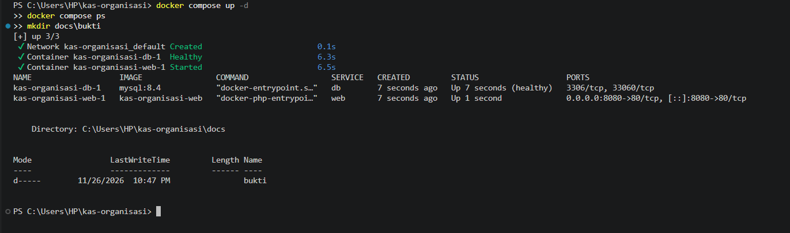
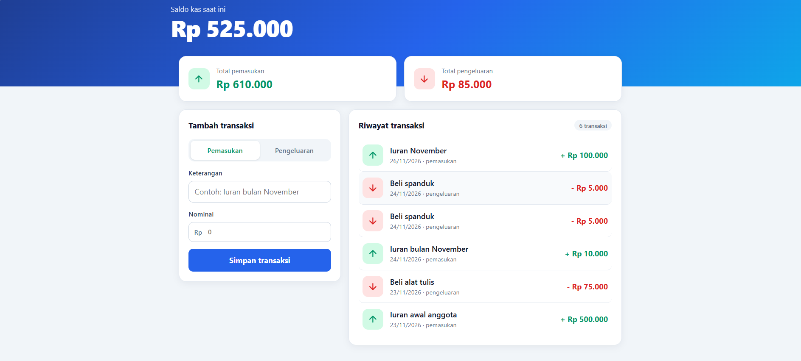
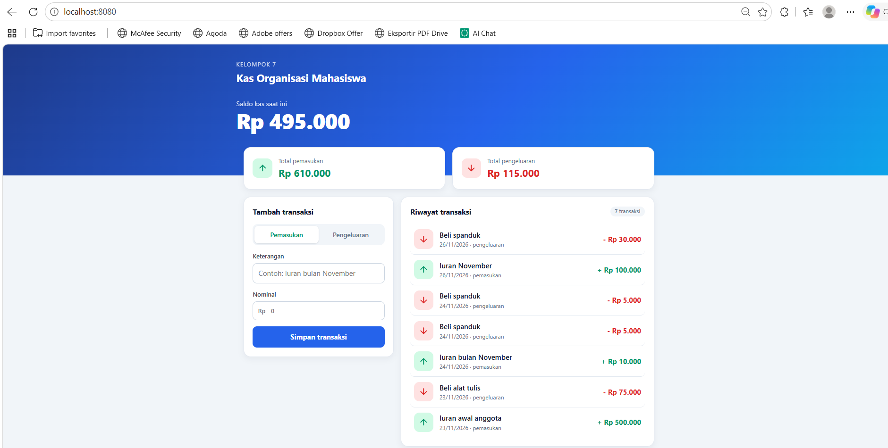
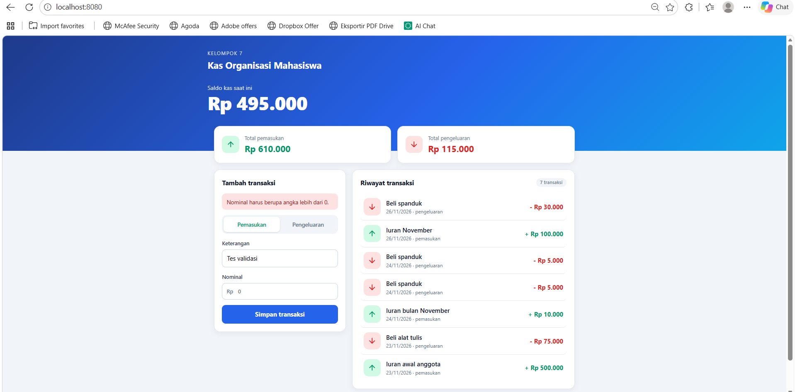
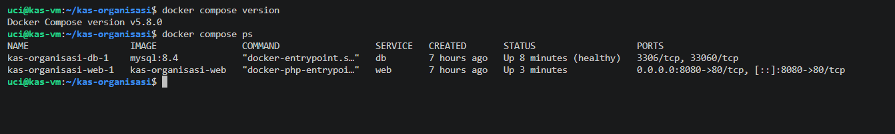
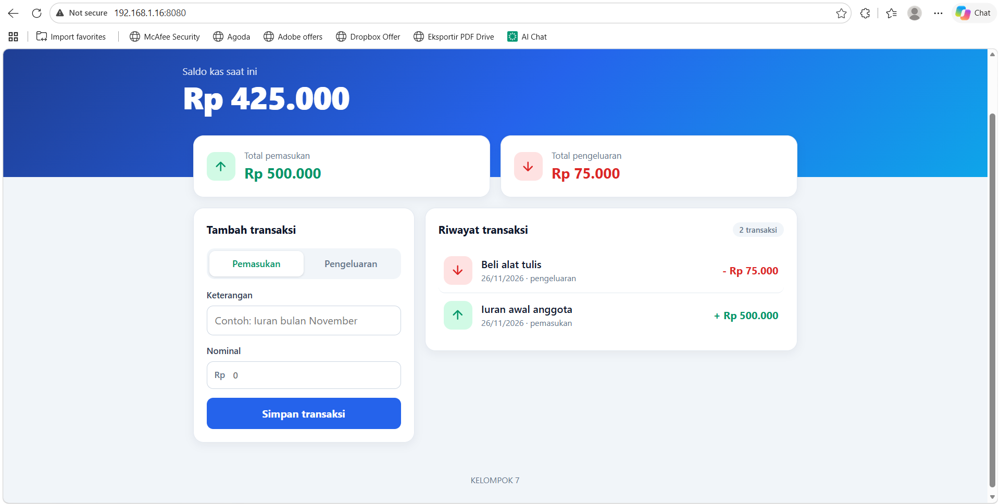
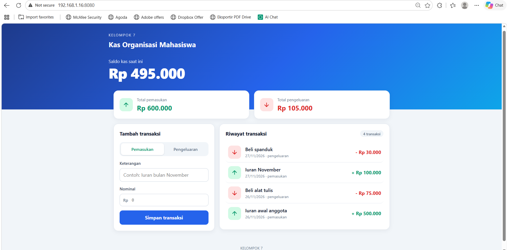
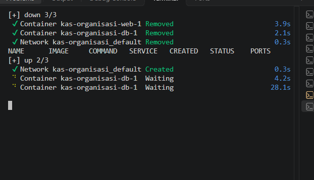
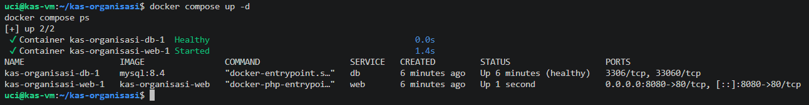
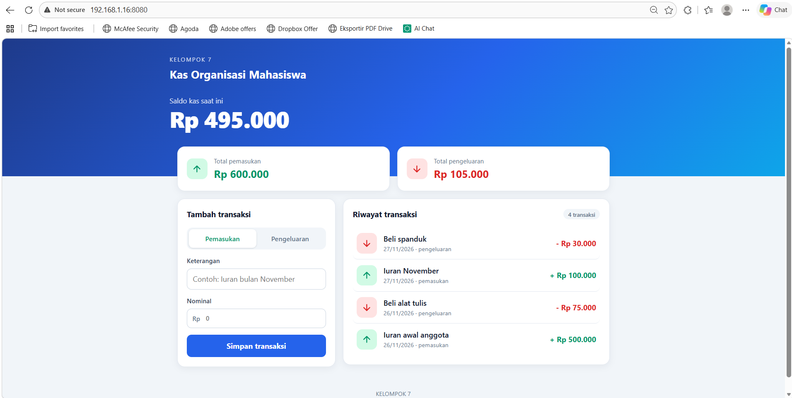

# Laporan Pengujian

Stack yang sama (`web` berbasis php:8.3-apache dan `db` berbasis mysql:8.4) diuji di dua lingkungan.

| Lingkungan | Tanggal | Alamat | Bukti |
|---|---|---|---|
| Docker Desktop di Windows | 26 November 2026 | `http://localhost:8080` | [bukti/](bukti/) |
| VM Ubuntu Server 24.04 LTS (VirtualBox, jaringan bridged) dengan Docker Engine dan Compose v5.8.0 | 27 November 2026 | `http://192.168.1.16:8080` | [bukti-vm/](bukti-vm/) |

## Ringkasan

| No | Skenario | Docker Desktop | VM Ubuntu |
|---|---|---|---|
| 1 | Akses web | Lulus | Lulus |
| 2 | Tambah transaksi | Lulus | Lulus |
| 3 | Hitung saldo | Lulus | Lulus |
| 4 | Persistensi data | Lulus | Lulus |
| 5 | Validasi input | Lulus | Tidak diuji ulang (kode aplikasi sama) |

# Bagian A. Docker Desktop (Windows)

## Kondisi awal

Stack dijalankan dengan `docker compose up -d`. `web` berstatus Up dan `db` berstatus healthy.

## Skenario 1: Akses web

- **Langkah:** buka `http://localhost:8080`.
- **Diharapkan:** halaman aplikasi tampil.
- **Hasil:** halaman tampil dengan 5 transaksi awal. Saldo Rp 425.000 (pemasukan Rp 510.000 dikurangi pengeluaran Rp 85.000).

## Skenario 2: Tambah transaksi

- **Langkah:** pilih Pemasukan, isi keterangan `Iuran November` dan nominal `100000`, lalu klik **Simpan transaksi**.
- **Diharapkan:** transaksi muncul di daftar.
- **Hasil:** baris `Iuran November + Rp 100.000` muncul di paling atas riwayat. Jumlah transaksi menjadi 6 dan saldo Rp 525.000.

## Skenario 3: Hitung saldo

- **Langkah:** tambah satu pengeluaran, yaitu `Beli spanduk` dengan nominal `30000`.
- **Diharapkan:** saldo sama dengan total pemasukan dikurangi total pengeluaran.
- **Hasil:** total pemasukan Rp 610.000 dan total pengeluaran Rp 115.000, sehingga saldo Rp 495.000 (610.000 − 115.000 = 495.000).

## Skenario 4: Persistensi data

- **Langkah:** jalankan `docker compose down`, `docker compose ps`, lalu `docker compose up -d`, kemudian muat ulang halaman.
- **Diharapkan:** data transaksi masih ada.
- **Hasil:** setelah `down`, `docker compose ps` kosong (container dan jaringan dihapus). Setelah `up -d` dan halaman dimuat ulang, ketujuh transaksi dan saldo Rp 495.000 sama dengan sebelumnya, karena data tersimpan di volume `db_data`.

## Skenario 5: Validasi input

- **Langkah:** isi keterangan `Tes validasi`, kosongkan nominal, lalu klik **Simpan transaksi**.
- **Diharapkan:** ditolak dengan pesan kesalahan.
- **Hasil:** muncul pesan "Nominal harus berupa angka lebih dari 0." Data tidak bertambah (tetap 7 transaksi dan saldo Rp 495.000).

# Bagian B. VM Ubuntu Server

Proyek diambil dari repositori dengan `git clone`, file `.env` dibuat di VM, lalu stack dijalankan dengan `docker compose up -d --build`. Database di VM berdiri sendiri, jadi datanya berbeda dari Docker Desktop (mulai dari 2 transaksi awal pada `init.sql`).

## Kondisi awal: host siap

- **Langkah:** jalankan `docker compose version` dan `docker compose ps` di VM.
- **Diharapkan:** Compose terpasang, `web` berstatus Up dan `db` berstatus healthy.
- **Hasil:** Docker Compose versi v5.8.0. `web` Up dan `db` Up (healthy).

## Skenario 1: Akses web

- **Langkah:** dari browser di laptop (host VirtualBox), buka `http://192.168.1.16:8080`.
- **Diharapkan:** halaman aplikasi tampil.
- **Hasil:** halaman tampil dengan 2 transaksi awal. Saldo Rp 425.000 (pemasukan Rp 500.000 dikurangi pengeluaran Rp 75.000).

## Skenario 2 dan 3: Tambah transaksi dan hitung saldo

- **Langkah:** tambah pemasukan `Iuran November` Rp 100.000 dan pengeluaran `Beli spanduk` Rp 30.000.
- **Diharapkan:** kedua transaksi muncul di daftar dan saldo sama dengan total pemasukan dikurangi total pengeluaran.
- **Hasil:** 4 transaksi. Total pemasukan Rp 600.000 dan total pengeluaran Rp 105.000, sehingga saldo Rp 495.000 (600.000 − 105.000 = 495.000).

## Skenario 4: Persistensi data

- **Langkah:** jalankan `docker compose down`, lalu `docker compose up -d`, kemudian muat ulang halaman.
- **Diharapkan:** data transaksi masih ada.
- **Hasil:** `down` menghapus container `web` dan `db` beserta jaringannya. Setelah `up -d`, kedua container berjalan lagi dan halaman menampilkan 4 transaksi dengan saldo Rp 495.000, sama seperti sebelumnya. Data tersimpan di volume `db_data`.

Tangkapan layar `down` diambil saat `up -d` masih menunggu database siap, karena VM sedang lambat memulai MySQL.

