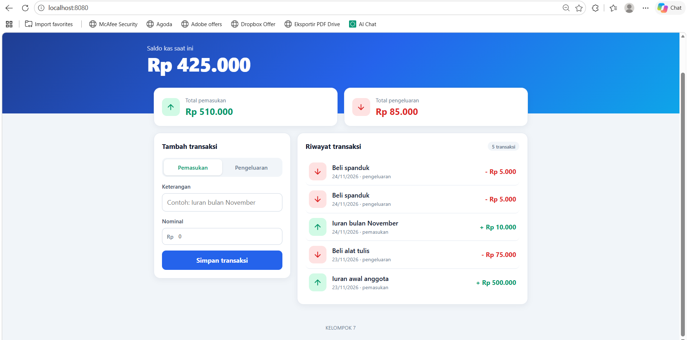
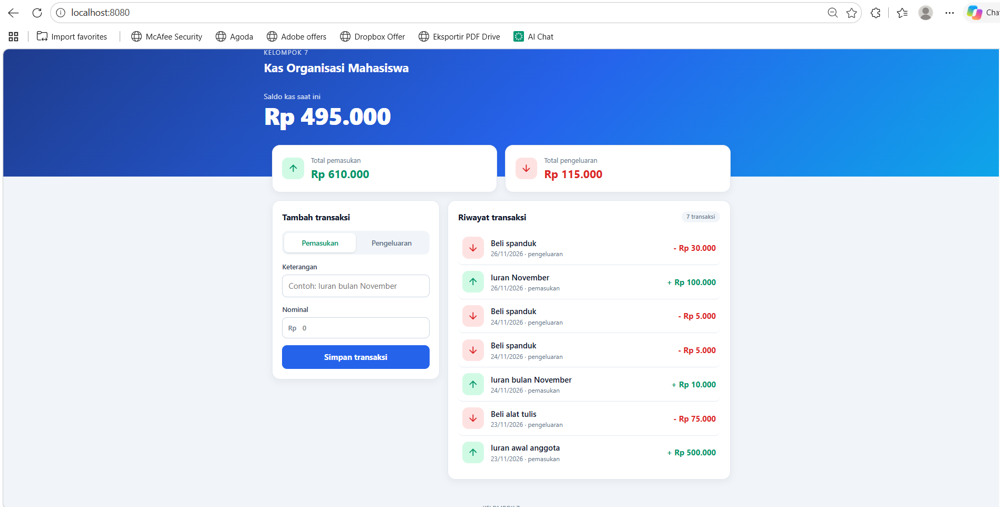
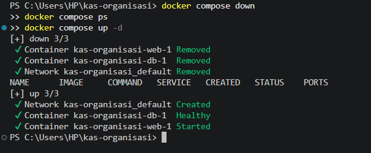

# Laporan Pengujian

| Keterangan | Isi |
|---|---|
| Tanggal | 26 November 2026 |
| Lingkungan | Docker Desktop di Windows |
| Stack | `web` (php:8.3-apache) dan `db` (mysql:8.4) |
| Alamat | `http://localhost:8080` |

## Ringkasan

| No | Skenario | Hasil |
|---|---|---|
| 1 | Akses web | Lulus |
| 2 | Tambah transaksi | Lulus |
| 3 | Hitung saldo | Lulus |
| 4 | Persistensi data | Lulus |
| 5 | Validasi input | Lulus |

## Kondisi awal

Stack dijalankan dengan `docker compose up -d`. `web` berstatus Up dan `db` berstatus healthy.

## Skenario 1: Akses web

- **Langkah:** buka `http://localhost:8080`.
- **Diharapkan:** halaman aplikasi tampil.
- **Hasil:** halaman tampil dengan 5 transaksi awal. Saldo Rp 425.000 (pemasukan Rp 510.000 dikurangi pengeluaran Rp 85.000).

## Skenario 2: Tambah transaksi

- **Langkah:** pilih Pemasukan, isi keterangan `Iuran November` dan nominal `100000`, lalu klik **Simpan transaksi**.
- **Diharapkan:** transaksi muncul di daftar.
- **Hasil:** baris `Iuran November + Rp 100.000` muncul di paling atas riwayat. Jumlah transaksi menjadi 6 dan saldo Rp 525.000.

## Skenario 3: Hitung saldo

- **Langkah:** tambah satu pengeluaran, yaitu `Beli spanduk` dengan nominal `30000`.
- **Diharapkan:** saldo sama dengan total pemasukan dikurangi total pengeluaran.
- **Hasil:** total pemasukan Rp 610.000 dan total pengeluaran Rp 115.000, sehingga saldo Rp 495.000 (610.000 − 115.000 = 495.000).

## Skenario 4: Persistensi data

- **Langkah:** jalankan `docker compose down`, `docker compose ps`, lalu `docker compose up -d`, kemudian muat ulang halaman.
- **Diharapkan:** data transaksi masih ada.
- **Hasil:** setelah `down`, `docker compose ps` kosong (container dan jaringan dihapus). Setelah `up -d` dan halaman dimuat ulang, ketujuh transaksi dan saldo Rp 495.000 sama dengan sebelumnya, karena data tersimpan di volume `db_data`.

## Skenario 5: Validasi input

- **Langkah:** isi keterangan `Tes validasi`, kosongkan nominal, lalu klik **Simpan transaksi**.
- **Diharapkan:** ditolak dengan pesan kesalahan.
- **Hasil:** muncul pesan "Nominal harus berupa angka lebih dari 0." Data tidak bertambah (tetap 7 transaksi dan saldo Rp 495.000).

